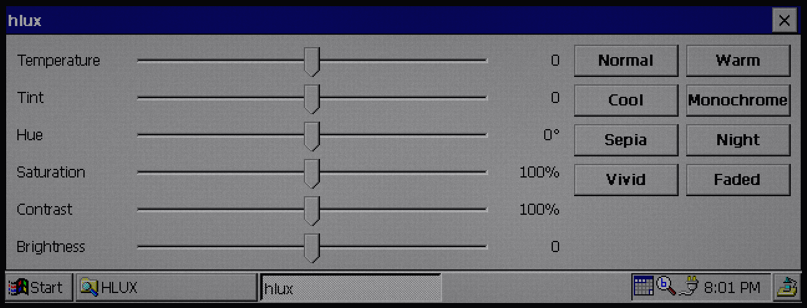
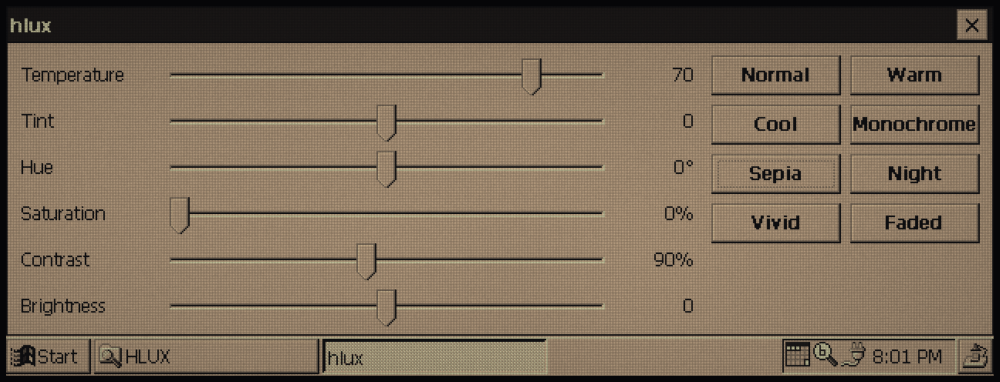
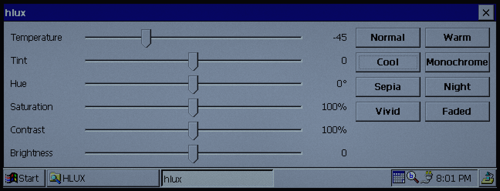

# hlux

A display colour palette tuner for the HP 620LX (Windows CE 2.0, SH3). It rewrites the HD64461's 256-entry palette, so the whole screen changes: the taskbar, every window and the desktop.

| Normal | Sepia | Cool |
| --- | --- | --- |
|  |  |  |

Settings: temperature, tint, hue, saturation, contrast and brightness. Presets: Normal, Warm, Cool, Monochrome, Sepia, Night, Vivid and Faded. Settings are kept in `HKCU\Software\hlux` and applied again when hlux starts. The palette stays adjusted after hlux closes, until the next reset.

It works from CE's system palette (`GetSystemPaletteEntries`), falling back to reading the hardware palette, and maps the HD64461's registers at physical 0x10001000 with `VirtualCopy`. The palette is 6 bits per channel.

## Building

Needs [velo-toolchain](https://github.com/Gadgetoid/velo-toolchain) and an LLVM with the SuperH backend, and mtools for the card image.

```sh
make card VELO_TOOLCHAIN=../../velo-toolchain VELO_SH3_LLVM=../llvm/install
```

`build/hlux.img` is a 32 MB FAT16 CompactFlash image with `\HLUX\hlux.exe`. In sh3-emu, insert it with `--card=build/hlux.img` (or the card menu) and run it from `\Storage Card\HLUX`.
