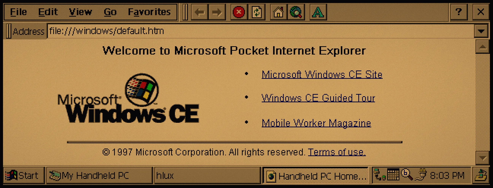
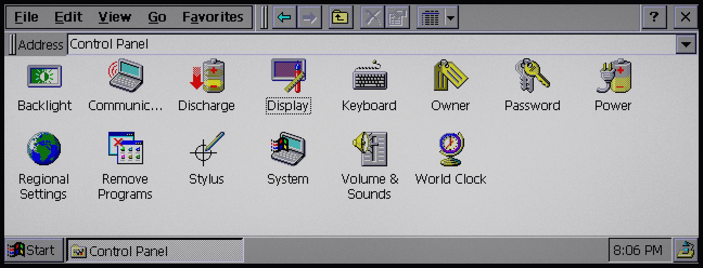
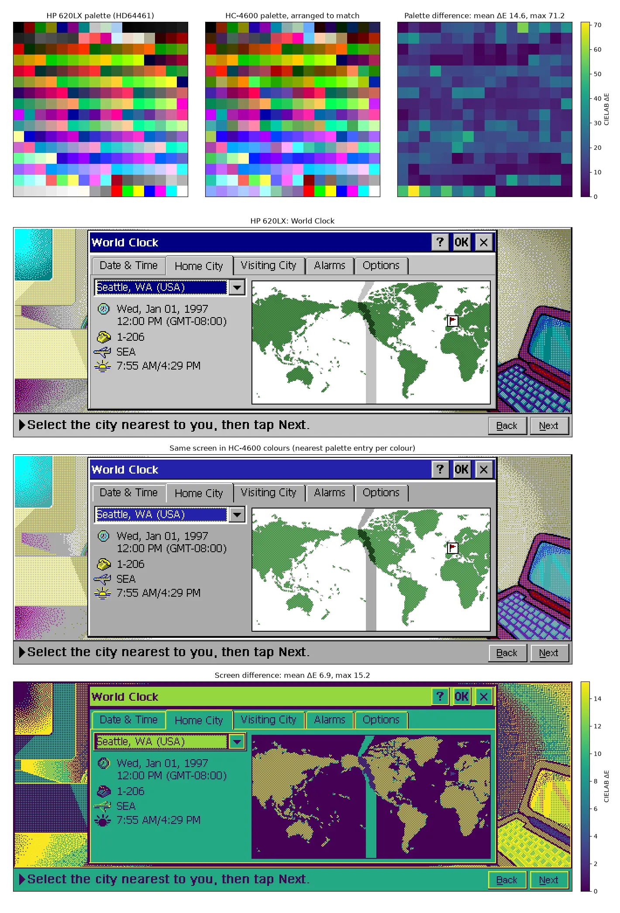
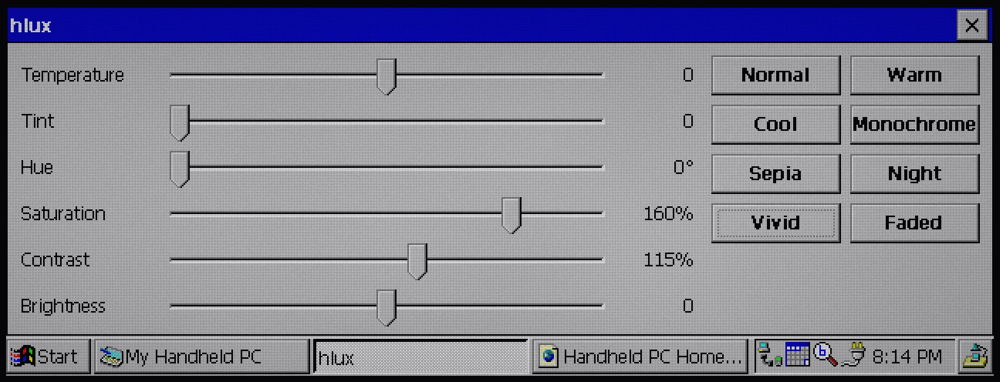
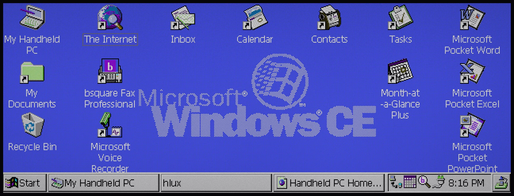
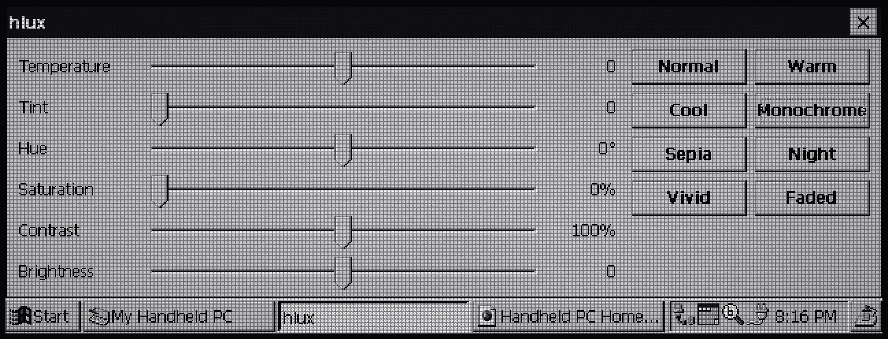
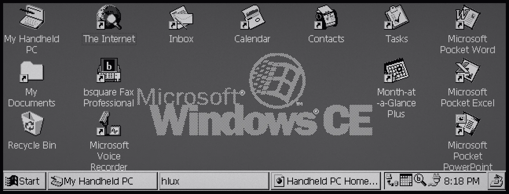

# hlux

f.lux, but for the HP 620LX. A display colour palette tuner for Windows CE 2.0 on the HP 620LX: night mode, sepia, monochrome, high contrast or PURPLE, at no performance cost whatsoever, because it only rewrites the display controller's palette.



Tested only in [sh3-emu](https://github.com/Gadgetoid/sh3-emu) so far. I lack a 620LX.

## Why this works

It started with someone asking why some Handheld PCs have odd colours, like the greys on this Sharp Mobilon HC-4500 with their blue and purple tinge:



The answer is colour quantisation, not system integrators who just liked purple. With only 256 colours, the Sharps use RGB332, which is well known for its fundamental tradeoffs:

1. Only two bits of depth for blue.
2. Its colours are evenly spread across the spectrum, so...
3. It's really bad at grey gradients.

HP's 620LX, probably by being slightly newer and spending more on a display controller (the Hitachi HD64461), uploads an 18-bit, 256-entry palette to it. Same 8 bits on the wire, but much more choice of colours.

Here are the two side by side: both palettes and the difference between them, a typical screen on the 620LX and the same screen in HC-4600 colours, and where they differ most:



The biggest differences land right on the greys: HP's hand-tuned greyscale gives a uniform, grown-up grey, and the HC-4600's gives an endearing, absolute hot mess.

But if the 620LX has a hardware palette, it can be changed, and the whole display recolours with it.

## Presets

Vivid, Monochrome, and "everything weird":

|  |  |
| --- | --- |
|  |  |

And a high-contrast accessible mode, in monochrome with boosted contrast and a bit more brightness:



The sliders cover temperature, tint, hue, saturation, contrast and brightness. The presets are Normal, Warm, Cool, Monochrome, Sepia, Night, Vivid and Faded. Settings are kept in `HKCU\Software\hlux` and applied again when hlux starts. The palette stays adjusted after hlux closes, until the next reset.

## How

**The whole screen changes, with zero runtime cost.** Every pixel in the 620LX's frame buffer is an 8-bit index, and the HD64461 looks each one up in its palette as it drives the panel. hlux rewrites those 256 entries once, then gets out of the way. Nothing redraws, no pixels are touched and nothing keeps running: every app, the taskbar and the desktop all come out recoloured for free, even after hlux has closed.

hlux starts from CE's system palette (`GetSystemPaletteEntries`), or reads the hardware palette back if that fails. It maps the HD64461's registers at physical 0x10001000 with `VirtualCopy` and writes all 256 entries, 6 bits per channel.

## Installing

Releases have `hlux-VERSION-sh3-ce2.exe` and a CompactFlash card image (`hlux-VERSION-card.zip`, a 32 MB FAT16 image with `\HLUX\hlux.exe`). Copy the exe to the 620LX, or in sh3-emu insert the card image and run `\Storage Card\HLUX\hlux.exe`.

## Building

Needs [velo-toolchain](https://github.com/Gadgetoid/velo-toolchain), an LLVM with the SuperH backend from [velo-llvm-builds](https://github.com/Gadgetoid/velo-llvm-builds/releases/tag/v1), and mtools for the card image.

```sh
make card VELO_TOOLCHAIN=../../velo-toolchain VELO_SH3_LLVM=/path/to/velo-llvm-v1-macos-arm64
```

GitHub Actions builds every push and attaches the exe and card image to a release for each `v*` tag.
